# AgniSetu

**A harmonized MODIS and VIIRS burning activity calendar, built on NASA FIRMS data.**

NASA Space Apps Challenge 2026, Delhi. Challenge: *Harmonization of MODIS and VIIRS Hot Spots*.

"Agni" is fire and "Setu" is bridge. Satellites have recorded active fires since November 2000, but
the record is split between two instrument generations that cannot be compared directly: MODIS sees
fires in 1 km pixels, VIIRS in 375 m pixels, and VIIRS reports several times more detections for the
same burning. AgniSetu bridges the two into one continuous record for any area you choose, and turns
that record into a calendar that answers three questions:

1. When does burning normally happen here?
2. How unusual is this season, this week, this year?
3. What is likely in the next two weeks?

Every number is labeled as observed or estimated, estimates carry an 80 percent interval, and missing
data is never shown as zero.

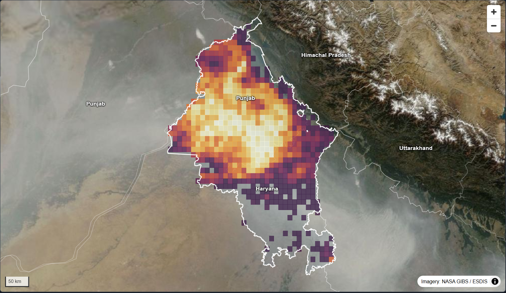

*Fire activity over Punjab and Haryana on NASA GIBS true color imagery, with the smoke of the same days.
Every picture on this page is a screenshot of the running app on real NASA FIRMS data.*

## What it found in the real data

The store holds the full FIRMS archive for India, Pakistan and Argentina (22.5 million detections,
2000 to 2025) plus every day of 2026 so far, 24.1 million detections in all. Two regions on two
continents, with opposite seasons, run through the same method with no region specific settings.

For the default area of Punjab and Haryana:

| Finding | Value |
| --- | --- |
| False jump in fire counts at 2012 when sensors are used as detected | 5.0 times |
| Same step after harmonization | 1.1 times |
| Independent check: the same years seen by MODIS alone | 1.1 times, the same as the harmonized record |
| Weekly error on held out years with no correction | 78 percent |
| Weekly error after harmonization (leave one year out) | 22 percent |
| Critical periods detected automatically | April 30 to May 13 (wheat residue), October 8 to November 18 (paddy residue, 72 percent of the year) |
| Shift in autumn onset | About 8 days later per decade, statistically significant |
| Satellite outages rediscovered from the data alone | Terra October 2022, Aqua April 2022, S-NPP July to August 2022, and more |
| Most and least active years | 2016 is the highest year on record; the autumn seasons of 2024, 2025 and 2026 so far are the three lowest on record |
| Live status at build time | VIIRS S-NPP silent since November 2, 2026; NOAA-20 carries the record through cross calibration |

For Argentina, the country of the challenge author's own example:

| Finding | Value |
| --- | --- |
| Change in fire counts at 2012 when sensors are used as detected | 2.4 times more |
| Same change after harmonization | 0.73 times, a fall of 27 percent |
| Independent check: the same years seen by MODIS alone | 0.74 times. The rise was the sensor change; the real change was a fall |
| Weekly error on held out years, no correction and after | 70 percent and 12 percent |
| The fire the challenge names: Chilecito, La Rioja, July 2026 | 242 detections against a median of 12 for the same dates in 25 other years: 20 times the usual, the highest July on record, peaking on July 28 |
| Seasons found without configuration | Gran Chaco July 2 to December 2; La Pampa December 10 to March 10, one season across the new year; Corrientes two seasons, summer and late winter |
| Highest years | 2020 for the whole country and 2022 for Corrientes, the years of the widely reported fires there |

## The six tabs

| Tab | What it does |
| --- | --- |
| **Explore** | Pick an area (search the states and districts of India and Pakistan and the provinces and departments of Argentina, draw a rectangle or polygon, upload GeoJSON, or type a latitude and longitude with a radius or a bounding box). Pick any day or date range up to a year. See detections on NASA imagery by sensor or fire power, the harmonized total for the range with its rank against the same dates in every other year, and download the hotspots of the search as CSV. |
| **Calendar** | Year by month, week or day heat map from 2000, in a choice of four accessible color ramps. Switch between harmonized, raw MODIS and raw VIIRS to watch the sensor jump appear and disappear. The ten highest months and five highest years, the selected year against the historical median month by month, climatology with percentile bands and detected critical periods. |
| **Harmonization** | Annual record, the candidate calibration models with cross validated skill, overlap scatter, seasonal factor, held out predictions, a map of where the sensors disagree, and the coverage timeline with detected outages. |
| **Anomalies** | Seasons ranked by how unusual they were (percentile, ratio to the median, departure from the multi year average), a week by week anomaly grid, season timing by year, and trend tests in plain language. |
| **Early Warning** | Alert level, recent activity and the current month to date against history, season progress against the envelope of other years, a two week outlook with measured skill, and a bulletin. Any past date can be replayed. |
| **Data and Methods** | Every ingested file with row counts and SHA-256, live feed status, method, limitations, exports. |

Every chart, heat map and map has a Save image button, and the layout is checked at desktop, tablet and
phone widths.

## Screenshots

Whole pages of the running app, one per tab. Closer views of single charts are in
[docs/submission/assets](docs/submission/assets/).

### Explore

Pick an area and a date range, see the detections on NASA imagery and how the period compares with the
same dates in every year.

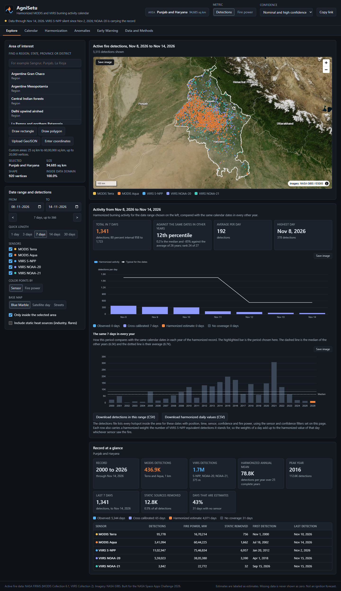

The smoke episode of early November 2016, on the true color imagery of the same day.

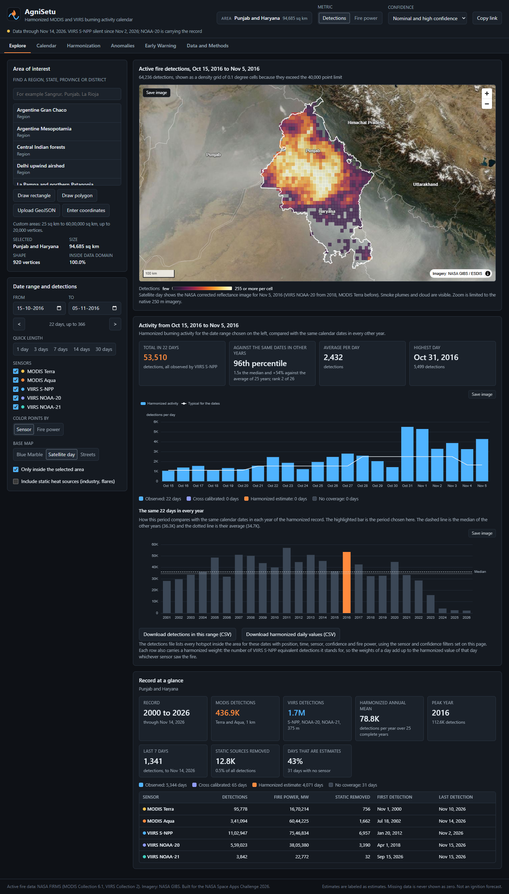

### Calendar

One row per year since 2000, the typical year, and the critical burning periods.

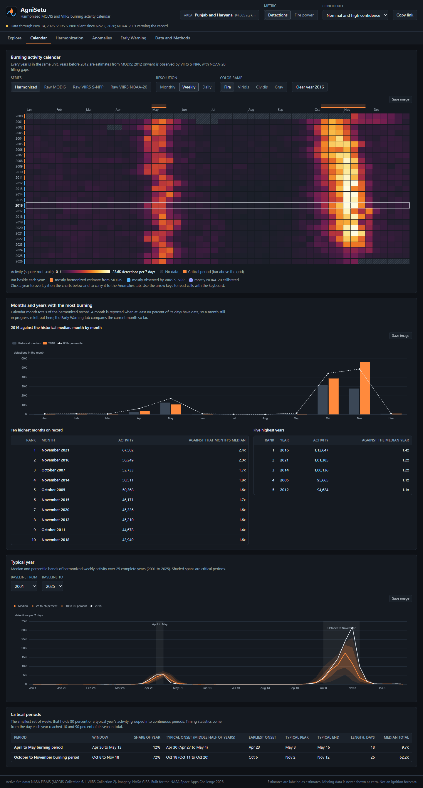

### Harmonization

The evidence: the record before and after, the candidate models and their validation, where the sensors
disagree, and when each sensor was silent.

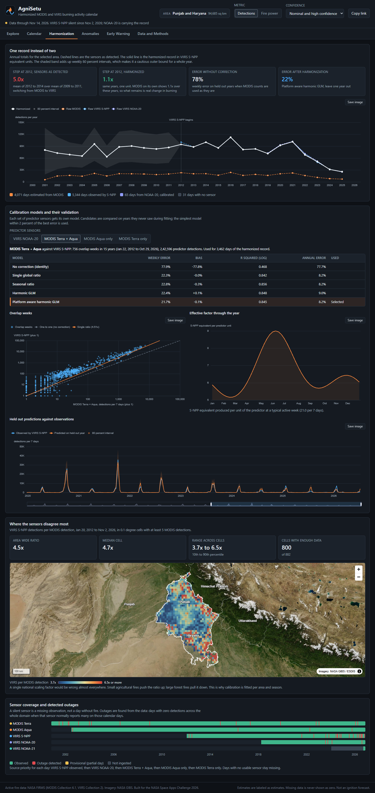

### Anomalies

Every season scored against all other years, and trend tests in plain language.

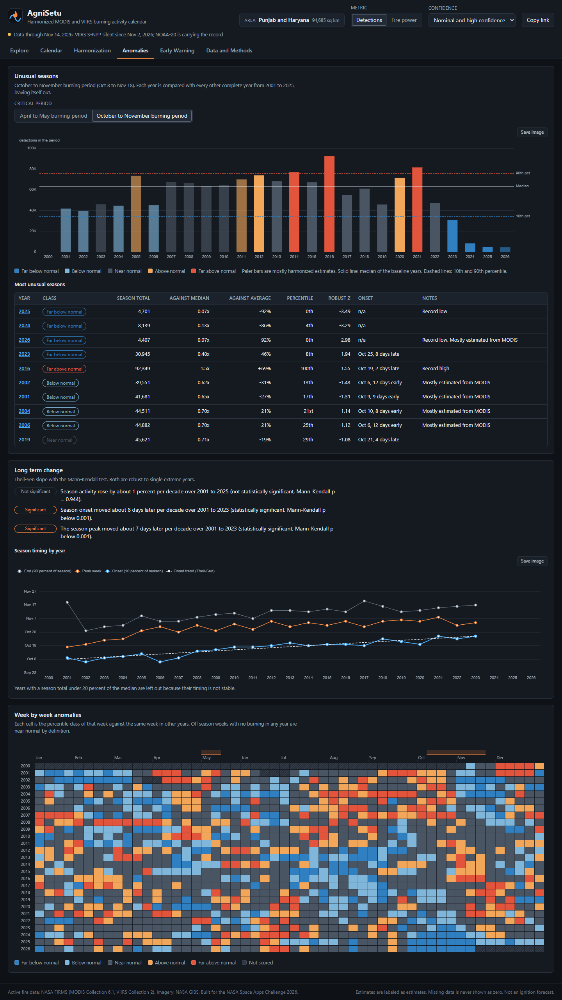

### Early Warning

Alert level, month to date, season progress and a two week outlook, today and replayed for November 5, 2016.

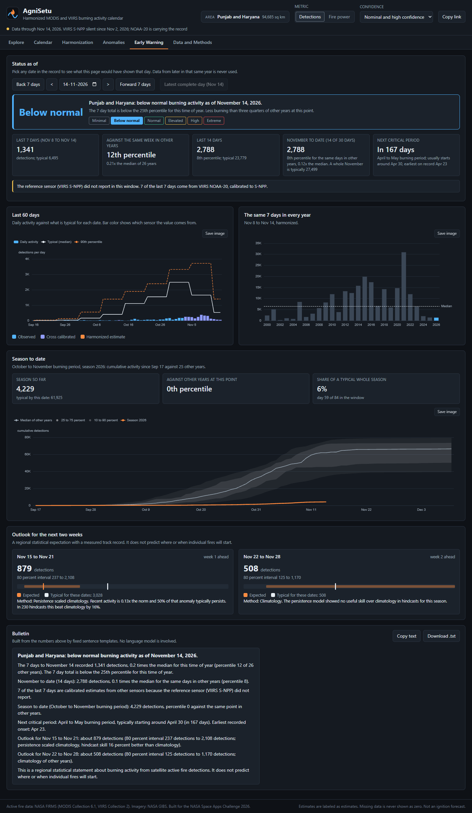

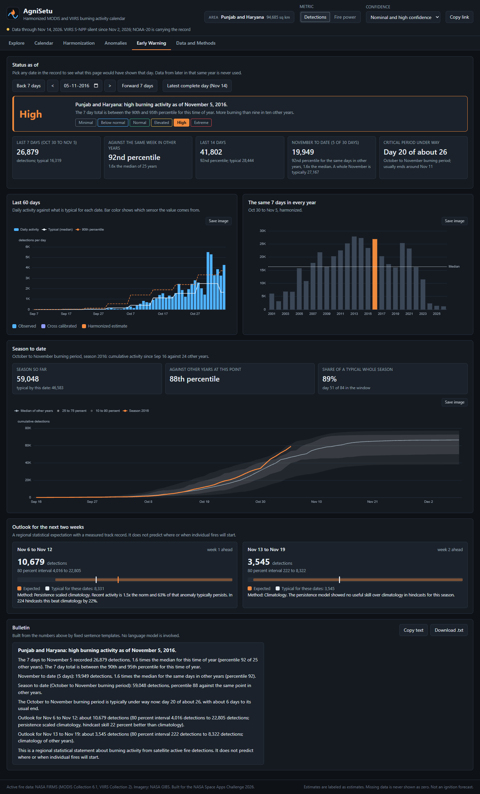

### Data and Methods

Every ingested file with its hash, live feed status, the method and its limits.

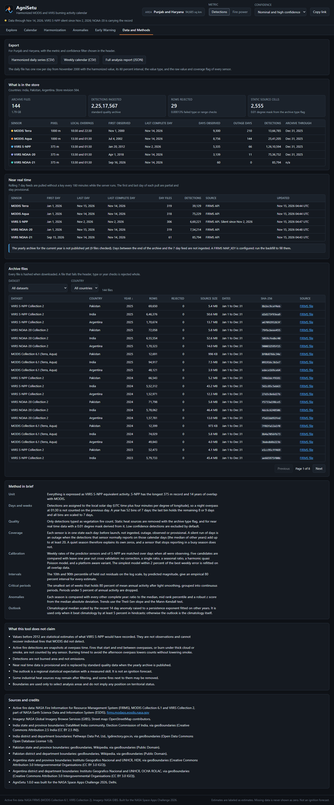

### Argentina

The fire named with the challenge: Chilecito, La Rioja, July 2026, and the same dates in every year.

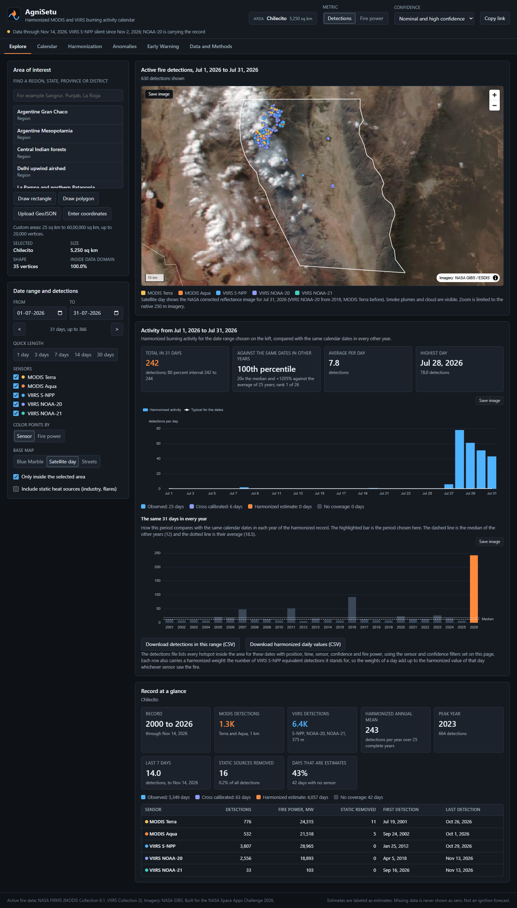

The whole country: used as detected, the sensors show 2.4 times more fire at 2012. Harmonized, the change
is a fall, as MODIS alone confirms.

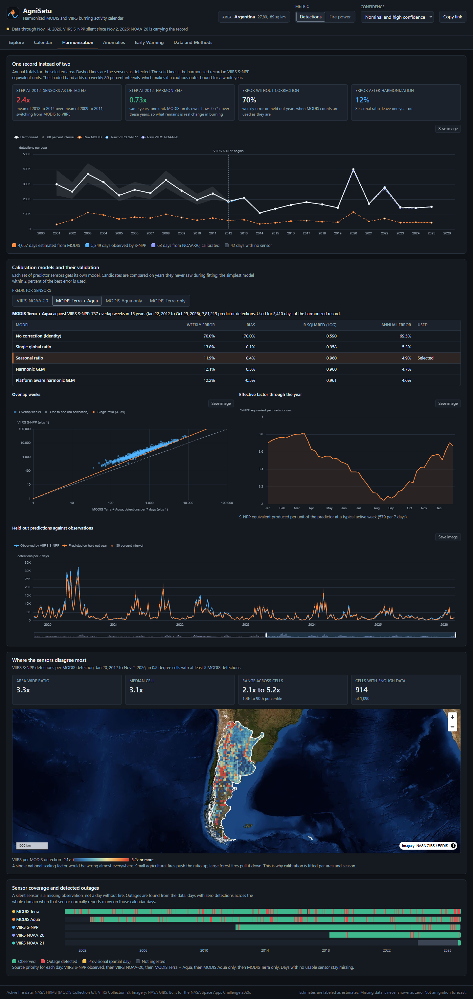

La Pampa, where the fire season runs from December to March, across the new year.

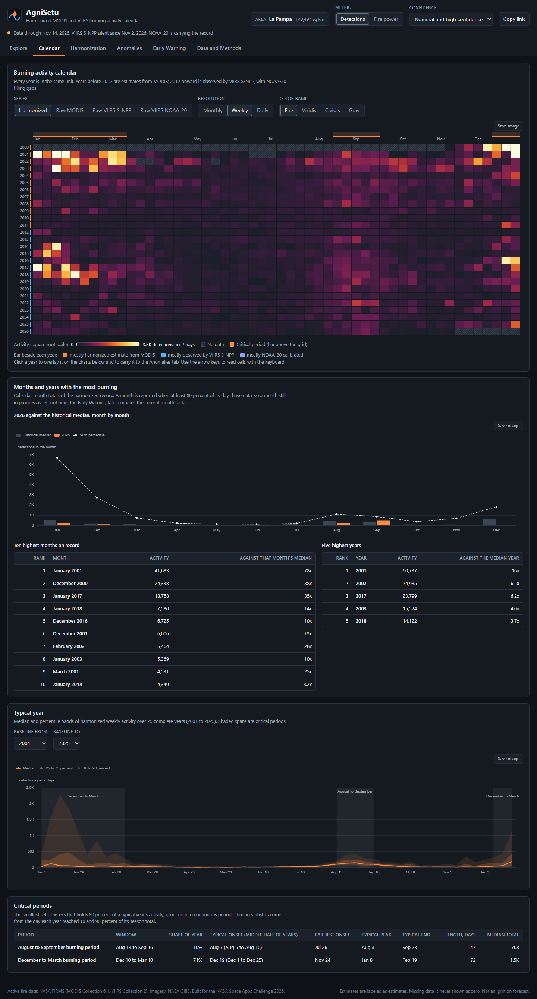

## How it covers the challenge brief

| The brief asks for | Where it is |
| --- | --- |
| Harmonize MODIS and VIIRS so the sensor of origin no longer matters | Harmonization tab; one unit everywhere; a harmonized weight on every downloaded hotspot |
| A burning activity calendar from the early 2000s to the present | Calendar tab, November 2000 to yesterday |
| Which months and years had the highest fire activity | Calendar tab, month by year view, ten highest months, five highest years |
| The current month against the historical median | Early Warning tab, month to date; Calendar tab, year against the median |
| Select a region and a specific date range | Explore tab: search, draw, upload, coordinates; From and To dates |
| Download analytics and visualizations | CSV of the daily series, the calendar and a date range; JSON report; Save image on every chart and map |
| A downloadable CSV of the hotspots detected during a search | Explore tab, "Download detections in this range (CSV)" |
| A map to draw the area, or latitude and longitude entry | Explore tab, Draw rectangle, Draw polygon, Enter coordinates |
| Accessible color ramps that show differences across months | Four ramps that rise steadily in lightness, including Cividis; hatching for missing data |
| Historical comparisons and anomalies against multi year averages | Anomalies tab; the date range card; season progress |
| Number of fires detected and reported | Explore tab, record at a glance and the table by sensor |
| How a current fire compares with previous ones | The same dates in every year, on the Explore and Early Warning tabs |
| Early warning for responders | Early Warning tab: alert level, outlook with measured skill, bulletin |

## Quick start

Requirements: Python 3.11 or later and Node.js 20.19 or later. Nothing else is needed: no database
server, no account and no key. Tested on Windows 11 with Python 3.13 and Node 24.

One command sets everything up and starts the server:

```bash
python scripts/run.py
```

On Windows you can also double click `scripts\start.bat`; in PowerShell run `scripts\start.ps1`; on macOS
and Linux run `scripts/start.sh`. Then open http://127.0.0.1:8000. The app opens on the Explore tab, shown
at the top of this page; every tab is pictured under [Screenshots](#screenshots).

### What the script does

| Step | First run | Every later run |
| --- | --- | --- |
| 1. Python | Stops with a clear message if Python is older than 3.11 | Same check |
| 2. Python packages | Creates `backend/.venv` and installs the versions pinned in `backend/pyproject.toml` | Compares every installed version with its pin and reinstalls only if one is missing or different |
| 3. Frontend packages | Checks Node.js, then `npm ci` from `package-lock.json` | Compares every installed package with the lock file and runs `npm ci` only on a difference |
| 4. Frontend build | `npm run build` | Rebuilds only when a source file is newer than the build |
| 5. Data | Creates `.env` from `.env.example`, downloads the FIRMS yearly archive (about 1.8 GB, 10 to 30 minutes), reads the live 7 day feeds | Asks the store what it lacks and fetches only that: missing archive files, the last days from the live feeds, and with a FIRMS key the days in between |
| 6. Server | Starts the app on one port | Same, after checking the port is free |

A download can be interrupted with Ctrl+C; the next run continues where it stopped. Without a network
the script still starts the server on the data it already has.

A later run, when nothing needs doing, takes a few seconds:

```text
[1/6] Python
  ok: Python 3.13.13

[2/6] Python environment and pinned packages
  ok: 11 pinned packages match pyproject.toml

[3/6] Frontend packages
  ok: node_modules matches package-lock.json

[4/6] Frontend build
  ok: frontend/dist is up to date

[5/6] Configuration and NASA FIRMS data
  ok: 144 archive files, every day through 2026-11-15

[6/6] Server
  starting AgniSetu at http://127.0.0.1:8000  (Ctrl+C to stop)
```

| Option | Effect |
| --- | --- |
| `--check` | Only report what is ready and what is not. Changes nothing. Exit code 0 means ready to serve |
| `--skip-data` | Set up the software but do not download or refresh data |
| `--no-serve` | Set everything up and stop before starting the server |
| `--open` | Open the app in the default browser when the server starts |
| `--host H`, `--port P` | Bind address and port, instead of `AGNISETU_HOST` and `AGNISETU_PORT` |

### How the scripts fit together

```
scripts/start.bat   scripts/start.ps1   scripts/start.sh      find a Python, pass arguments through
            \              |               /
                  scripts/run.py                               standard library only; decides what is needed
                        |
     pip install -e "backend[dev]"                             pinned Python packages
     npm ci, npm run build                                     frontend packages and build
     agnisetu check                                            what the store holds and lacks (no network)
     agnisetu ingest-archive, refresh-nrt, backfill-api        the data the check asked for
     agnisetu serve                                            the application
```

Every step is one of the project's own commands, so anything the script does can also be done by hand.

### The same steps by hand

```bash
# 1. Backend
cd backend
python -m venv .venv
.venv/Scripts/python -m pip install -e ".[dev]"        # on macOS or Linux: .venv/bin/python

# 2. Data: full FIRMS archive for India, Pakistan and Argentina (about 1.8 GB download, 10 to 30 minutes)
.venv/Scripts/python -m agnisetu.cli ingest-archive
.venv/Scripts/python -m agnisetu.cli refresh-nrt

# 3. Frontend
cd ../frontend
npm ci
npm run build

# 4. Run (serves the API and the built frontend on one port)
cd ../backend
.venv/Scripts/python -m agnisetu.cli serve
```

### Filling the current year (optional, recommended)

The keyless yearly archive ends on December 31 of last year and the keyless live feed covers the last
7 days. The days in between need a free FIRMS key:

1. Request a MAP_KEY at https://firms.modaps.eosdis.nasa.gov/api/map_key/
2. Copy `.env.example` to `.env` and set `AGNISETU_FIRMS_MAP_KEY`
3. Run `python scripts/run.py` again (it sees the key and runs `agnisetu backfill-api` for the missing days)

The backfill asks FIRMS for one region at a time (South Asia, then South America), each with its own
bounding box, and is resumable.

Without it everything works, and the app says clearly which statistics are withheld because days are
missing (for example the season to date total for the current year).

### Commands

| Command | Purpose |
| --- | --- |
| `agnisetu ingest-archive [--countries India Pakistan Argentina] [--from-year Y] [--to-year Y]` | Download and convert yearly archive files. Resumable; finished files are skipped |
| `agnisetu refresh-nrt` | Pull the rolling 7 day feeds. Also runs every 3 hours inside the server |
| `agnisetu backfill-api [--start YYYY-MM-DD]` | Fill the gap through the FIRMS area API (needs MAP_KEY). Reads the FIRMS availability table first and takes each date from the source that holds it: standard quality for older months, near real time for recent ones. Resumable |
| `agnisetu check` | Report what the store holds and what it still lacks, as JSON, without touching the network. The start script acts on this report |
| `agnisetu status` | Print coverage by sensor |
| `agnisetu serve [--host H] [--port P]` | Run the application |

## Tests

```bash
cd backend
.venv/Scripts/python -m pytest              # 151 tests: units, engines, regions, start script, API, security, real data
.venv/Scripts/python -m ruff check agnisetu tests

cd ../frontend
npm run typecheck && npm run lint && npm test    # TypeScript strict, ESLint, 36 unit and component tests
npm run e2e                                      # 488 browser checks against a running server
npm run e2e:layout                               # layout audit: every tab at four screen widths
```

`npm run e2e` drives an installed Chrome or Edge. It clicks every control on every tab, opens thirteen
very different areas (one district, a forest state, islands with almost no fire, a whole country, and
in Argentina a department, a province whose season crosses the new year and Tierra del Fuego)
on all six tabs, simulates an unreachable server and a rate limit and checks recovery, and checks the
390 pixel layout.

`npm run e2e:layout` opens every tab at 1440, 1024, 760 and 390 pixels and fails when text overlaps
other text, a control overlaps another control, content is cut off or the page scrolls sideways.

`python scripts/sweep_areas.py 70` runs every analysis for all regions, all states and a sample of
districts, for both metrics, and asserts invariants such as "every value lies inside its interval".

## How the harmonization works

* **Unit.** VIIRS S-NPP equivalent activity (detections or megawatts of fire radiative power).
* **Calibration.** For each set of predictor sensors (Terra plus Aqua, Aqua only, Terra only, NOAA-20),
  weekly rates are matched with S-NPP over the days when all were observing. Five candidates are
  compared with leave one year out cross validation: no correction, one global ratio, a seasonal
  ratio, a harmonic quasi Poisson model, and a platform aware variant. The simplest model within 2
  percent of the best error is used. The "no correction" baseline always stays in the table.
* **Intervals.** The 10th and 90th percentile of held out residuals give an empirical 80 percent
  interval for every estimate.
* **Coverage.** Each sensor is, each day, before launch, not ingested, in outage, observed or
  provisional. A silent run is an outage when the detections that sensor normally reports on those
  calendar days add up to at least 20, so a quiet season explains its own zeros and a dead sensor does
  not. A day with no usable sensor stays missing.
* **Regions.** The domain can hold countries from different FIRMS regions, here South Asia and South
  America. Each region is fetched with its own bounding box, has its own coverage and its own outage
  detection, and every day file records which regions it holds. A day that lacks a region is unknown
  for that region, never zero, and a failed feed for one region does not hide the other.
* **Small areas.** When an area has too few overlapping detections, the model is trained on a wider
  area, at most the region the area lies in, and the app says which one.
* **Independent check.** Next to the step at 2012 the app shows the same years as seen by MODIS alone.
  One instrument compared with itself contains no sensor change, so it is a yardstick the harmonized
  record should match, and does.
* **Single hotspots.** Each row of the hotspot download carries a harmonized weight, the number of
  S-NPP equivalent detections it stands for. A reference sensor detection weighs 1 on a day that sensor
  observed. On other days the harmonized value of the day is shared among the detections it was
  estimated from. The weights of a day add up to the harmonized value of that day.

The full method, the data model, the API and the security design are in [docs/PRD.md](docs/PRD.md).
The threat model is in [docs/SECURITY.md](docs/SECURITY.md).

## Architecture

```
NASA FIRMS (archive CSV, 7 day feeds, area API)
        |
   ingestion: download from one allow listed host, hash, validate, normalize
        |
   Parquet store + JSON manifest (provenance, revision)
        |
   DuckDB (in process)  ->  per area daily cube (cached)  ->  harmonization
        |                                                        |
   FastAPI /api/v1  <-  calendar, anomalies, early warning  <----+
        |
   React + TypeScript single page app (MapLibre, ECharts), served by the same process
```

No database server, no paid service, no API key required. After ingestion the analysis works
offline; only map tiles need a connection.

## Configuration

All settings are environment variables with the prefix `AGNISETU_`, read from `.env` in the
repository root. See [.env.example](.env.example). The important ones:

| Variable | Default | Meaning |
| --- | --- | --- |
| `AGNISETU_FIRMS_MAP_KEY` | unset | Free FIRMS key for the current year backfill |
| `AGNISETU_ADMIN_TOKEN` | unset | Enables the ingestion controls on the Data tab. Without it those routes do not exist |
| `AGNISETU_COUNTRIES` | `India,Pakistan,Argentina` | Analysis domain. Supported: India, Pakistan, Nepal, Bangladesh, Bhutan, Sri_Lanka, Argentina |
| `AGNISETU_HOST`, `AGNISETU_PORT` | `127.0.0.1`, `8000` | Bind address |
| `AGNISETU_ALLOWED_HOSTS` | `localhost,127.0.0.1` | Accepted Host headers |
| `AGNISETU_NRT_REFRESH_MINUTES` | `180` | Live feed refresh interval, 0 to disable |
| `AGNISETU_HEAVY_RATE_LIMIT_PER_MINUTE` | `180` | Analysis and export requests allowed per client per minute |

To add a country that is already in the catalog: add it to `AGNISETU_COUNTRIES`, run
`python scripts/build_boundaries.py --add Nepal`, then `ingest-archive` and `backfill-api`. A country
outside the catalog needs one line in `backend/agnisetu/firms.py` (its FIRMS file name, ISO code and
FIRMS region). Argentina was added this way during the hackathon.

## Limitations

* Values before 2012 are statistical estimates of what VIIRS S-NPP would have recorded. They are not
  observations and cannot recover individual fires that MODIS did not detect.
* Active fire detections are snapshots at overpass time. Fires that start and end between overpasses,
  or burn under thick cloud or smoke, are not counted by any sensor. Burning timed to avoid the
  afternoon overpass lowers counts without lowering smoke.
* Detections are not burned area and not emissions.
* Near real time data is provisional until the yearly archive replaces it.
* The outlook is a regional statistical expectation with a measured skill. It does not predict where or
  when individual fires will start.
* Boundaries are used only to select analysis areas and do not imply any position on territorial status.

## Use of AI tools

This project was built with Claude Code by Anthropic, an AI coding assistant. Under the participant's
direction it proposed the technical design and wrote the code, the tests and the documentation. No AI
generated images, video, audio or data are used: every figure is a screenshot of the running
application drawing real NASA data, and the application itself contains no language model. The full
statement is in [docs/submission/AI_USE.md](docs/submission/AI_USE.md).

## Submission material

* [docs/submission/PROJECT_PAGE.md](docs/submission/PROJECT_PAGE.md): text for every field of the Space
  Apps project page.
* `docs/submission/AgniSetu_demo.pdf`: the 7 slide demo, built by
  `node frontend/e2e/deck.mjs --team "Team name" --members "Names"` from the screenshots in
  `docs/submission/assets` (`node frontend/e2e/capture.mjs`).
* `docs/screenshots`: whole page screenshots of every tab, made by `node frontend/e2e/pages.mjs`.

## Data and credits

We acknowledge the use of data from NASA's Fire Information for Resource Management System (FIRMS),
part of NASA's Earth Science Data and Information System (ESDIS): MODIS Collection 6.1 and VIIRS
Collection 2 active fire products. Imagery from NASA Global Imagery Browse Services (GIBS). State and
district boundaries from geoBoundaries (DataMeet India community and Election Commission of India,
CC BY 2.5 IN; Pathways Data and lgdirectory.gov.in, ODbL 1.0; Pakistan sets, public domain; Argentina
provinces and departments from Instituto Geografico Nacional with UNHCR and OCHA, CC BY 3.0 IGO). Street
map tiles from OpenStreetMap contributors.

NASA does not endorse this project.
