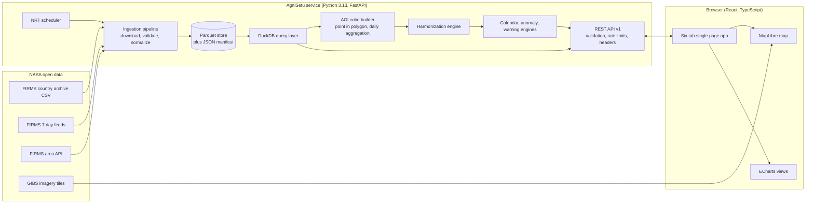

# AgniSetu: Product Requirements, Architecture and Build Plan

**Product:** AgniSetu, a harmonized MODIS and VIIRS burning activity calendar
**Event:** NASA Space Apps Challenge 2026, Delhi local event (November 14 to 15, 2026)
**Challenge:** Harmonization of MODIS and VIIRS Hot Spots (Earth Science, Software; Intermediate and Advanced)
**Document version:** 1.1
**Status:** Built and verified (see section 17)

"Agni" is fire and "Setu" is bridge. The product bridges two generations of NASA fire sensors into one
consistent record, and turns that record into a calendar that tells a fire manager when burning normally
happens in their area, how this year compares, and what the next two weeks are likely to bring.

---

## 1. Executive summary

Satellites have recorded active fire hotspots since November 2000, but the record is split across sensors
that cannot be compared directly. MODIS on Terra and Aqua sees fires in 1 km pixels. VIIRS on S-NPP and
NOAA-20 sees them in 375 m pixels and reports several times more detections for the same burning,
especially for small agricultural fires. A naive chart of "fire counts per year" therefore shows a false
jump in 2012 when VIIRS arrives, and anyone comparing 2005 with 2024 is comparing two different
instruments.

The gap is not only historical. At build time (November 14, 2026) the VIIRS S-NPP near real time feed
returned zero detections worldwide while NOAA-20, NOAA-21, Terra and Aqua were all reporting. Any tool that
treats S-NPP as "the VIIRS record" silently goes dark. Continuity across sensors is an operational
requirement today.

AgniSetu solves this in one web application:

1. It ingests the complete NASA FIRMS record for a country (MODIS from 2000, VIIRS S-NPP from 2012,
   VIIRS NOAA-20 from 2018) plus the live near real time feeds.
2. For any area of interest drawn or selected by the user, it fits a calibration between the sensors on
   the years where they overlap, validates it with leave one year out cross validation against simple
   baselines, and produces one continuous daily series from 2000 to today in a single unit: VIIRS S-NPP
   equivalent detections (or fire radiative power).
3. It turns that series into a burning activity calendar: a year by week heat map, a climatology with
   percentile bands, automatically detected critical periods, anomaly rankings, trend tests and an early
   warning view with a two week statistical outlook.
4. Every number is labeled as observed, cross calibrated or harmonized estimate, carries a prediction
   interval where it is an estimate, and can be traced to a source file with a SHA-256 hash.

The flagship demonstration is crop residue burning in Punjab and Haryana, the dominant fire story for the
Delhi National Capital Region every October and November. The same tool works for any area inside the
ingested countries.

### What makes this entry different

| Common approach | AgniSetu |
| --- | --- |
| Synthetic fixtures or a few days of sample data | The full real archive: 26 years of MODIS, 14 years of S-NPP, 8 years of NOAA-20 for India, Pakistan and Argentina, two regions with opposite seasons |
| A single global scaling factor, or an unvalidated model | Five candidate models per area, selected by leave one year out cross validation, with baselines shown next to the winner |
| Treats a silent sensor as "zero fires" | Explicit per platform, per day coverage states: pre launch, not ingested, outage, observed, provisional |
| Fixed regions | Any polygon: draw, upload GeoJSON, or pick from the states and districts of India and Pakistan and the provinces and departments of Argentina |
| Static charts | Six linked tabs driven by one analysis engine, with CSV and JSON export and a replayable "as of" date |

---

## 2. Problem statement and challenge mapping

### 2.1 The official challenge

> Build a web application that harmonizes these records into a burning activity calendar based on active
> fire hotspots, enabling early warning and emergency responders, scientists, and land managers to examine
> historical fire patterns, unusual conditions, and critical periods within a selected area of interest.

The objective text adds that the calendar should combine "the extensive historical series of MODIS with the
continuity and greater detail of VIIRS to provide a consistent time series of hotspot activity".

### 2.2 Requirement extraction

| ID | Challenge requirement | Product response | Section |
| --- | --- | --- | --- |
| C1 | Web application | Single page React application served by a FastAPI service | 8, 10 |
| C2 | Harmonize MODIS and VIIRS records | Per area calibration with cross validated model selection and prediction intervals | 6.3 |
| C3 | Burning activity calendar | Year by week and year by day heat maps, climatology bands | 5.2, 6.4 |
| C4 | Selected area of interest | Presets (states, districts, curated regions), drawn rectangle or polygon, GeoJSON upload | 5.1 |
| C5 | Historical fire patterns | Continuous 2000 to present series, seasonality, trends | 5.2, 5.4 |
| C6 | Unusual conditions | Leave one out anomaly scoring of seasons, weeks and timing | 5.4, 6.5 |
| C7 | Critical periods | Automatic detection of burning seasons with onset, peak and end statistics | 6.4 |
| C8 | Early warning | Current status level, season progress envelope, two week outlook, bulletin | 5.5, 6.6 |
| C9 | Consistent time series | One unit (VIIRS S-NPP equivalent) with value type labels and intervals | 6.3 |
| C10 | Sensor of origin no longer matters | The same unit in every view, and a harmonized weight on every downloaded hotspot | 5.1, 6.3 |
| C11 | Which months and years had the highest activity | Month by year calendar, ten highest months, five highest years | 5.2 |
| C12 | Current month against the historical median | Month to date on the Early Warning tab, selected year against the median month by month | 5.2, 5.5 |
| C13 | A region and a specific date range | Search, draw, upload or type coordinates; From and To dates up to a year | 5.1 |
| C14 | Download analytics and visualizations | CSV and JSON exports, Save image on every chart, heat map and map | 5.1 to 5.6 |
| C15 | CSV of the hotspots detected during a search | Detection download for the chosen area, dates, sensors and confidence | 5.1 |
| C16 | Latitude and longitude entry | Point with radius, or bounding box | 5.1 |
| C17 | Accessible color ramps | Four ramps that rise steadily in lightness, hatching for missing data | 5.2 |
| C18 | Anomalies against multi year averages | Percent departure from the mean of the other years, next to percentile and median ratio | 5.4 |
| C19 | How a current fire compares with previous ones | The same calendar dates in every year for any day or range | 5.1, 5.5 |
| C20 | The example in the challenge video: the Chilecito, La Rioja fire of July 2026 | Argentina is ingested as a second region. Chilecito is a preset area and July 2026 ranks first of all years for those dates | 6.1, 6.3, 17 |

### 2.3 Why the sensors disagree

* **Pixel size.** MODIS pixels are 1 km at nadir and grow to about 2 km by 4.8 km at the scan edge. VIIRS
  I band pixels are 375 m with far less growth. Small, cool fires that fill a negligible fraction of a
  MODIS pixel are detected by VIIRS.
* **One fire, many pixels.** A fire front that triggers one MODIS pixel can trigger several VIIRS pixels.
* **Overpass time.** Terra crosses near 10:30 and 22:30 local time, Aqua, S-NPP and NOAA-20 near 13:30 and
  01:30. Residue fires are lit in the afternoon, so Terra sees a different slice of the day.
* **Fire type.** The VIIRS to MODIS ratio is not a constant. It is larger for small agricultural fires than
  for forest fires, and it changes with season inside the same district.
* **Record length.** Terra starts November 2000, Aqua July 2002, S-NPP January 2012, NOAA-20 April 2018
  (FIRMS archive), NOAA-21 January 2024.

A correct harmonization therefore has to be local, seasonal, aware of which platforms were flying, and
validated.

---

## 3. Goals, non goals and success metrics

### 3.1 Goals

* G1. A user can go from "open the app" to "a 26 year harmonized calendar for my district" in under 60
  seconds without reading documentation.
* G2. The harmonized series is demonstrably better than no correction and better than a single global
  factor, with the evidence shown in the app.
* G3. The app never presents an estimate as an observation, and never presents missing data as zero.
* G4. An emergency planner gets a clear answer to three questions: are we in a critical period, is current
  burning unusual, what is likely in the next two weeks.
* G5. Everything runs on real NASA data, end to end, on a laptop, with no paid services.
* G6. The service is safe to expose on a network: validated inputs, bounded resource use, no secrets in
  the client, hardened headers.

### 3.2 Non goals

* Predicting the location or time of individual ignitions. The outlook is regional and statistical.
* Burned area mapping, emissions inventories or air quality forecasting.
* Replacing FIRMS. The product is an analysis layer on top of FIRMS data.
* Global ingestion out of the box. The architecture is country agnostic and the catalog covers South
  Asia and Argentina; the demonstration deployment ingests India, Pakistan and Argentina.
* User accounts. All data is public and no personal data is stored, so there is nothing to protect behind
  a login. Administrative ingestion endpoints are protected by a shared secret.

### 3.3 Success metrics

| Metric | Target | How it is measured |
| --- | --- | --- |
| Harmonization skill, Punjab plus Haryana | Selected model beats identity and global ratio on out of fold weighted absolute percentage error | Harmonization tab model table; `tests/test_real_data.py` |
| Structural break at 2012 | Ratio of mean annual activity 2012 to 2019 over 2003 to 2011 is near 1 for harmonized, far above 1 for naive concatenation | Harmonization tab continuity card |
| Time to first calendar, cold cache, state sized AOI | Under 5 seconds | Server timing header, browser check |
| Time to calendar, warm cache | Under 300 ms | Server timing header |
| Rejected rows in archive ingestion | Reported per file, total under 0.1 percent | Data tab, manifest |
| Automated tests | All pass | `pytest`, `vitest`, type check, lint, build |
| Accessibility | Keyboard reachable controls, labeled inputs, WCAG AA contrast for text | Manual pass plus axe style checks in component tests |

---

## 4. Users and journeys

### 4.1 Personas

| Persona | Context | What they need |
| --- | --- | --- |
| **Harpreet, district agriculture officer, Sangrur** | Deploys enforcement and awareness teams for the paddy residue season | When does burning usually start here, are we ahead of or behind a normal year, how bad is this week |
| **Dr. Meera, air quality scientist, Delhi** | Builds emission inputs and writes seasonal assessments | A defensible long term series without the 2012 sensor jump, with uncertainty and method documentation |
| **Arjun, state disaster management duty officer** | Forest fire season in Uttarakhand, February to June | Critical period dates, an alert level, a short bulletin to forward |
| **Sana, journalist** | Explaining stubble burning trends to the public | A clear picture of whether fires are really falling, and which years were unusual |
| **Judge or reviewer** | Evaluating validity and completeness | Proof that the harmonization is real, validated and honest about limits |

### 4.2 Primary journey

1. Open the app. The Explore tab shows the map with the default area (Punjab and Haryana) and the most
   recent detections.
2. Choose an area: search a state or district, pick a curated region, draw a rectangle or polygon, or
   upload a GeoJSON file. The server validates the geometry and reports its size and how much of it lies
   inside the ingested domain.
3. Read the headline: record length, detections by sensor, share of static heat sources removed.
4. Open Calendar. See 26 rows of years, each a strip of 52 weeks. Toggle between raw MODIS, raw VIIRS and
   harmonized to see the sensor jump appear and disappear. Critical periods are shaded and listed.
5. Open Harmonization. See the overlap scatter, the candidate models with cross validated skill, the
   seasonal calibration curve, the spatial ratio map, and the sensor coverage timeline.
6. Open Anomalies. See which seasons were unusual, by how much, and whether onset is drifting.
7. Open Early Warning. See the alert level for the latest data date, the season progress curve against
   the historical envelope, the two week outlook with its interval and measured skill, and a plain
   language bulletin. Move the "as of" date to replay any day in the record.
8. Open Data and Methods. See every ingested file with row counts and hashes, the method in plain terms,
   limitations, and export buttons.

### 4.3 Secondary journeys

* **Share.** The area, metric, filters, tab and "as of" date are encoded in the URL. Opening the link
  restores the same view.
* **Export.** Download the harmonized daily series, the weekly calendar matrix, or the full analysis
  report as CSV or JSON for use in other tools.
* **Operate.** An operator with the admin token triggers a near real time refresh or an API backfill from
  the Data tab or the command line and watches the job status.

---

## 5. Functional requirements by tab

All six tabs share one area of interest, one metric (detections or fire radiative power), one confidence
filter and one analysis result. Changing any of them updates every tab.

**Global controls (header):** area picker summary, metric toggle, confidence filter (all detections;
nominal and high, default; high only), share link, data freshness indicator.

### 5.1 Tab 1: Explore (map and area selection)

| ID | Requirement | Acceptance criteria |
| --- | --- | --- |
| EX-1 | Map with NASA imagery | MapLibre map. Base layers: NASA GIBS Blue Marble, NASA GIBS daily true color linked to the selected date (MODIS Terra before 2018, VIIRS NOAA-20 after), OpenStreetMap streets. State outlines and names are drawn from the boundary data shipped with the application, so orientation does not depend on a third party label service. Attribution shown. |
| EX-2 | Preset areas | Search box over curated regions, states and districts. Selecting one loads its geometry from the server and fits the map to it. |
| EX-3 | Draw rectangle | Click and drag draws a rectangle. Escape cancels. The result is validated by the server before use. |
| EX-4 | Draw polygon | Click to add vertices, double click or Enter to close, Escape to cancel, Backspace removes the last vertex. Minimum three vertices. |
| EX-5 | Upload GeoJSON | Accepts a Polygon, MultiPolygon, Feature or FeatureCollection up to 512 KB. Invalid files produce a specific message. |
| EX-6 | Server validation | Geometry is repaired if self intersecting, rejected if outside size limits (25 to 6,000,000 square km) or vertex limit (20,000). Response includes area, bounding box and the share of the area inside the ingested domain. A warning is shown when that share is under 99 percent. |
| EX-7 | Hotspot layer | Detections inside the current map view for a selected date window, colored by sensor or by fire radiative power. Above 40,000 points the server returns a density grid instead, and the legend says so. |
| EX-8 | Date window | Date picker and window length (1, 3, 7, 14, 30 days) with previous and next controls. Defaults to the last 7 days with data. |
| EX-9 | Sensor filter | Toggle each platform on the map: Terra, Aqua, S-NPP, NOAA-20, NOAA-21. |
| EX-10 | Detection popup | Clicking a point shows platform, acquisition time in UTC and local solar time, fire radiative power, confidence, day or night, pixel size. |
| EX-11 | Headline cards | For the area: record span, total detections by instrument, static source detections removed, latest data date, harmonized annual mean. |
| EX-12 | States | Loading skeletons, empty state when no detections in the window, error banner with retry. |
| EX-13 | Coordinate entry | A form takes a latitude, longitude and radius in km, or the four edges of a bounding box, validates them and creates the area. |
| EX-14 | Date range | From and To date inputs for any range from one day to 366 days, with quick lengths and previous and next controls. |
| EX-15 | Date range report | Harmonized total with its 80 percent interval, percentile, rank, ratio to the median and percent departure from the multi year average for the same calendar dates in other years, a daily or weekly chart, and a bar for each year of the record. |
| EX-16 | Hotspot download | CSV of every detection in the area and range with position, time, sensor, confidence, fire power, type, quality, a harmonized weight and the value type of its day. The weights of a day add up to the harmonized value of that day. Limited to 400,000 rows. |
| EX-17 | Image download | The map and every chart can be saved as a PNG named after the area and the dates. |

### 5.2 Tab 2: Calendar

| ID | Requirement | Acceptance criteria |
| --- | --- | --- |
| CA-1 | Year by week heat map | One row per year from 2000, 52 columns. Color by activity on a perceptually ordered scale with square root stretch. Missing cells are hatched, not colored as zero. |
| CA-2 | Series switch | Harmonized (default), raw MODIS, raw VIIRS S-NPP, raw VIIRS NOAA-20. The raw views make the sensor discontinuity visible. |
| CA-3 | Daily resolution | Toggle to year by day of year (366 columns). |
| CA-4 | Cell detail | Hover or focus shows the week dates, value, value type, prediction interval for estimates, percentile among all years and coverage. |
| CA-5 | Climatology chart | Median line with 25 to 75 and 10 to 90 percentile bands by week, with any selected year overlaid. Critical periods shaded. |
| CA-6 | Baseline period | Start and end year for the climatology, defaulting to all complete years. |
| CA-7 | Critical periods table | For each detected period: typical start, peak and end dates, share of annual activity, median onset with interquartile range, median duration. |
| CA-8 | Value type legend | Observed reference, cross calibrated VIIRS, harmonized estimate, missing. Era boundaries are marked on the year axis. |
| CA-9 | Year selection | Clicking a row selects that year for overlay here and in the Anomalies tab. |
| CA-10 | Month by year view | Twelve columns, one per calendar month. A month is reported when at least 80 percent of its days have data. |
| CA-11 | Highest months and years | Table of the ten highest months and the five highest years on record, each with its ratio to the median, and a chart of the selected year against the historical median and 90th percentile month by month. |
| CA-12 | Color ramp choice | Fire, Viridis, Cividis and Gray. Each rises steadily in lightness, which a unit test checks. The choice is kept in the address. |

### 5.3 Tab 3: Harmonization

| ID | Requirement | Acceptance criteria |
| --- | --- | --- |
| HA-1 | Continuity card | Annual totals: naive concatenation (MODIS then VIIRS) against harmonized, with the 2012 step size stated for both. |
| HA-2 | Overlap scatter | Weekly MODIS against weekly S-NPP for overlap weeks, log axes, with the fitted relationship and the one to one line. |
| HA-3 | Model table | Every candidate model with out of fold weighted absolute percentage error, bias, log scale R squared and annual total error. The selected model is marked. Identity and global ratio are always present as baselines. |
| HA-4 | Seasonal calibration | Effective VIIRS to MODIS factor by week of year. |
| HA-5 | Validation chart | Observed S-NPP against out of fold predictions through the overlap years, with the prediction interval band. |
| HA-6 | Predictor sets | Separate fits for Terra plus Aqua, Terra only, Aqua only and NOAA-20, each with its sample size, training scope and skill. |
| HA-7 | Spatial ratio map | Grid of the VIIRS to MODIS detection ratio over the area for the overlap period, with a minimum sample mask. |
| HA-8 | Coverage timeline | Per platform bar showing observed, outage and not ingested periods across the record. |
| HA-9 | Fallback disclosure | When the area has too little overlap data the model is trained on a wider region. The tab states which region was used. |

### 5.4 Tab 4: Anomalies

| ID | Requirement | Acceptance criteria |
| --- | --- | --- |
| AN-1 | Season totals chart | Bar per year for a selected critical period, colored by anomaly class, with the median and percentile lines. |
| AN-2 | Ranked unusual seasons | Table sorted by absolute robust z score: year, period, total, ratio to median, percentile, class, record flags. |
| AN-3 | Weekly anomaly heat map | Year by week matrix of percentile class against the same week in other years. |
| AN-4 | Timing shifts | Onset, peak and end date per year for the selected period with deviation from the median in days. |
| AN-5 | Trends | Theil-Sen slope and Mann-Kendall significance for season total and for onset date, stated in plain language. |
| AN-6 | Estimate awareness | Years that rely on harmonized estimates are marked, and their interval is shown on the bars. |
| AN-7 | Against the multi year average | Each season shows its percent departure from the mean of the other baseline years, next to the ratio to the median. |

### 5.5 Tab 5: Early Warning

| ID | Requirement | Acceptance criteria |
| --- | --- | --- |
| EW-1 | Alert level | One of Minimal, Below normal, Normal, Elevated, High, Extreme for the as of date, with the rule that produced it. |
| EW-2 | Recent activity | Last 7 and last 14 days against the historical distribution of the same calendar window: value, percentile, ratio to median. |
| EW-3 | Season progress | Cumulative activity in the current critical period against the p10, p25, median, p75 and p90 envelope of other years. |
| EW-4 | Next critical period | Countdown to the typical onset of the next period, with earliest historical onset. |
| EW-5 | Two week outlook | Expected activity for the next two 7 day windows with an 80 percent interval, the method name and its measured hindcast skill against climatology. Falls back to climatology and says so when skill is not positive. |
| EW-6 | As of date | Date picker bounded by the record. Changing it recomputes the whole tab as it would have looked on that day, using only earlier data for the current year. |
| EW-7 | Bulletin | Plain language summary built from the numbers by fixed templates, with copy and download actions. |
| EW-8 | Data gaps | When the days needed for a statistic are not ingested, the statistic is withheld and the reason is shown, including how to backfill with a FIRMS key. |
| EW-9 | Month to date | Activity of the current calendar month so far against the same days of that month in other years: percentile and ratio to the median, with the typical total of a whole month. |

### 5.6 Tab 6: Data and Methods

| ID | Requirement | Acceptance criteria |
| --- | --- | --- |
| DM-1 | Ingestion table | Per dataset, country and year: rows, rejected rows, date span, source URL, SHA-256, ingestion time. Sortable and filterable. |
| DM-2 | Near real time status | Per platform: last complete day, provisional days, source (7 day feed or API), last refresh result. |
| DM-3 | Method summary | The harmonization, calendar, anomaly and outlook methods in plain terms with the exact parameters in use. |
| DM-4 | Limitations | A fixed, visible list of what the product does not claim. |
| DM-5 | Exports | Harmonized daily CSV, weekly calendar CSV, full report JSON for the current area and settings. |
| DM-6 | Operations | With an admin token: trigger near real time refresh and API backfill, see job state. Hidden when the server has no admin token configured. |
| DM-7 | Attribution | NASA FIRMS, LANCE, GIBS, geoBoundaries and OpenStreetMap credits and citation text. |

---

## 6. Data and scientific method

### 6.1 Data sources (verified November 14, 2026)

| Source | Access | Content | Record | Size for India |
| --- | --- | --- | --- | --- |
| FIRMS country archive, MODIS Collection 6.1 | Keyless HTTPS, one CSV per country and year | Terra and Aqua detections, standard quality, with fire type flag | 2000-11-01 to 2025-12-31 | 0.1 to 7.5 MB per year |
| FIRMS country archive, VIIRS S-NPP Collection 2 | Keyless | 375 m detections with type flag | 2012-01-20 to 2025-12-31 | about 45 MB per year |
| FIRMS country archive, VIIRS NOAA-20 Collection 2 | Keyless | 375 m detections with type flag | 2018-04-01 to 2025-12-31 | about 47 MB per year |
| FIRMS rolling 7 day feeds, South Asia and South America | Keyless | Near real time for MODIS, S-NPP, NOAA-20, NOAA-21, no type flag | Last 7 days | 0.4 to 1.6 MB per feed |
| FIRMS area API | Free MAP_KEY | Near real time by bounding box, up to 5 days per request | Fills the gap between the archive and the 7 day feed | Optional |
| NASA GIBS WMTS | Keyless, CORS enabled | Blue Marble and daily corrected reflectance true color tiles | 2000 to present | Tiles on demand |
| geoBoundaries gbOpen, and gbHumanitarian for Argentine provinces | Keyless | State, province, district and department polygons | Static | Built into the repository |

Archive columns: `latitude, longitude, brightness or bright_ti4, scan, track, acq_date, acq_time, satellite,
instrument, confidence, version, bright_t31 or bright_ti5, frp, daynight, type`.

### 6.2 Normalization and quality rules

Every source row is converted to one schema:

| Column | Type | Rule |
| --- | --- | --- |
| `lat`, `lon` | double | Must be finite and inside valid ranges |
| `acq_date`, `acq_time` | date, HHMM | UTC as published |
| `ldate` | date | Local solar date: UTC time plus four minutes per degree of longitude. Used for all calendars so a 01:30 night overpass is not assigned to the previous day |
| `platform` | 0 to 4 | Terra, Aqua, S-NPP, NOAA-20, NOAA-21 from the `satellite` code |
| `conf` | 0, 1, 2 | Low, nominal, high. MODIS percent confidence maps as under 30, 30 to 79, 80 and above. VIIRS letters map directly |
| `frp` | float | Megawatts, non negative |
| `is_day` | bool | From `daynight` |
| `scan`, `track`, `bright` | float | Pixel dimensions and channel brightness temperature |
| `ftype` | 0 to 3 | 0 vegetation fire, 1 volcano, 2 other static land source, 3 offshore |
| `is_nrt` | bool | Near real time quality |

* Rows that fail a type or range check are dropped and counted. The count is stored per file and shown.
* Only `ftype = 0` contributes to burning activity. Static sources are counted separately and reported.
* Near real time rows have no type flag. A 0.01 degree mask of cells dominated by static sources in the
  archive is applied to them.
* Near real time rows are clipped to the ingested countries so they match the archive footprint.
* The yearly archive always supersedes near real time data for the same dates.

### 6.3 Harmonization

**Reference unit.** VIIRS S-NPP 375 m. It has the longest VIIRS record and 14 years of overlap with MODIS.
All harmonized values are "S-NPP equivalent" detections or megawatts.

**Coverage states.** For each platform and day: pre launch, not ingested, outage, observed, provisional.
An outage is a run of days with zero detections across the whole ingested domain, where the detections
that platform normally reports on those calendar days (the median over other years and a 7 day
neighbourhood) add up to at least 20. Under a Poisson model that leaves a chance of about two in a
billion of seeing nothing, so a quiet season explains its own zeros and a silent sensor in a busy season
does not. A feed that returns no rows at all creates no coverage, so a silent satellite is never read as
a fire free day. On the real archive this rule rediscovers documented events without being told about
them: Terra in October 2022 and February 2016, Aqua in April 2022, S-NPP in July to August 2022.

**Time bins.** 52 bins per year: bin `w = min(floor((doy - 1) / 7), 51)`. The last bin holds 8 or 9 days.
All model inputs and outputs are expressed as 7 day rates, and a bin is used only when at least 5 of its
days are covered.

**Predictor sets.** Separate models are fitted for each combination of platforms that can stand in for
the reference:

| Set | Predictors | Used when |
| --- | --- | --- |
| TA | Terra plus Aqua | Both covered. Main model for 2002-07 to 2012-01 |
| T | Terra | Aqua not covered. 2000-11 to 2002-07 and Aqua outages |
| A | Aqua | Terra not covered |
| J1 | NOAA-20 | S-NPP not covered and NOAA-20 covered. Carries the record past S-NPP |

**Candidate models.** With `x` the weekly predictor rate, `y` the weekly S-NPP rate and `w` the bin:

1. Identity: `y = x`. The "no correction" baseline.
2. Global ratio: `y = r x`, `r = sum(y) / sum(x)`.
3. Seasonal ratio: `y = r(w) x`, where `r(w)` pools a circular window of plus or minus 3 bins and is
   shrunk toward the global ratio with a prior equal to one typical active week.
4. Harmonic GLM: quasi Poisson, log link,
   `log E[y] = b0 + b1 log(1 + x) + b2 sin(2 pi w / 52) + b3 cos(2 pi w / 52) + b4 sin(4 pi w / 52) + b5 cos(4 pi w / 52)`,
   fitted by iteratively reweighted least squares with a small ridge penalty.
5. Platform aware GLM (TA only): as 4, with `log(1 + x_Terra)` and `log(1 + x_Aqua)` as separate terms.

**Selection.** Leave one year out cross validation over the overlap years. For each model the out of fold
predictions give:

* weighted absolute percentage error, `sum|y - yhat| / sum(y)` (selection criterion),
* bias, `sum(yhat) / sum(y) - 1`,
* R squared on the `log(1 + y)` scale,
* mean absolute percentage error of annual totals.

The model with the lowest weighted error wins. A simpler model is preferred when it is within 2 percent
of the best.

**Sample size and fallback.** A fit needs at least 26 overlap weeks with a non zero predictor and a
predictor total of at least 100 detections. If the area does not meet this, training data is taken from
the area's bounding box buffered by 1 degree, then 3 degrees, then the whole domain. The app states the
scope that was used.

**Prediction intervals.** The 10th and 90th percentiles of out of fold residuals on the `log(1 + y)` scale,
stratified by predicted magnitude when there are at least 90 residuals, give an empirical 80 percent
interval for every estimate.

**Daily disaggregation.** A weekly estimate is distributed over the covered days of the bin in proportion
to the predictor's daily values, or evenly when the predictor is zero all week.

**Source priority per day.**

1. S-NPP observed: value type `reference`.
2. Otherwise NOAA-20 with the J1 model: `viirs_calibrated`.
3. Otherwise MODIS with the TA, then A, then T model: `modis_harmonized`.
4. Otherwise `missing`. Never zero.

**Regions.** A deployment can hold countries served by different FIRMS regions, here South Asia and
South America. Nothing is ever requested or judged on one box around all of them:

* The 7 day feeds and the area API are read one region at a time, each with the bounding box of its own
  countries, and each response is clipped to that region.
* A day file holds the rows of every region, and the manifest records for each file which regions it
  holds and whether each is final. A day that lacks a region is unknown for that region, not zero.
* Coverage and outage detection are computed per region. A sensor can be silent over one continent on a
  day it reports from another, and a quiet season in one hemisphere must not excuse silence in the other.
  The domain wide view shown on the Data tab is the weakest state across regions.
* An area takes the coverage of the region it lies in. When its calibration must borrow data from a
  wider area, the widest scope is that region.
* A store written before regions were tracked is upgraded on first load: its day files are stamped with
  the regions configured at that moment.

**Independent check of continuity.** The step at 2012 is shown three ways: sensors as detected, the
harmonized record, and MODIS alone over the same years (the mean of 2012 to 2014 over the mean of 2009 to
2011). MODIS compared with itself contains no sensor change, so it is a yardstick that does not depend on
the calibration. The harmonized step should match it. For Punjab and Haryana both are 1.1; for Argentina
the harmonized record gives 0.73 and MODIS alone 0.74, where the sensors as detected give 2.4.

**What the method does not do.** It does not invent individual fires that MODIS missed. It estimates how
much activity the reference sensor would have recorded, in aggregate, given what MODIS recorded, and it
reports how well that estimate performed on years where the answer is known.

### 6.4 Calendar and critical periods

* **Weekly matrix.** Harmonized weekly totals for each year, scaled to full bin length when 5 or more
  days are covered, missing otherwise.
* **Climatology.** For each bin over the baseline years: mean, median, 10th, 25th, 75th, 90th percentile,
  minimum, maximum, number of years.
* **Critical periods.** The mean climatology is smoothed with a circular 3 bin triangular kernel. Bins are
  ranked by share of annual activity and selected until they account for 80 percent. Selected bins are
  grouped into circular contiguous runs, single bin gaps are bridged, and runs with under 5 percent of
  annual activity are dropped unless they are the largest. Each run is one critical period.
* **Timing per year.** Inside each period window extended by 3 bins on both sides: onset is the day the
  cumulative activity reaches 10 percent of that year's window total, end is the day it reaches 90
  percent, peak is the center of the maximum 7 day sum. Years with a window total under 20 percent of the
  median are excluded from timing statistics because their timing is not stable.

### 6.5 Anomalies and trends

* **Season anomaly.** A year's period total is compared with all other baseline years: ratio to median,
  mid rank percentile, robust z score `(x - median) / (1.4826 MAD)`.
* **Classes.** Percentile at most 10 is "far below normal", 10 to 25 "below normal", 25 to 75 "near
  normal", 75 to 90 "above normal", above 90 "far above normal". Record high and record low are flagged.
* **Weekly anomaly.** The same percentile classing per bin. Bins where both the value and the median are
  zero are "near normal".
* **Trends.** Theil-Sen slope with Mann-Kendall two sided p value (normal approximation with tie
  correction) for period totals and for onset day. Reported as percent per decade and days per decade.

### 6.6 Early warning and outlook

For an as of date `t` (default: the latest day with complete data):

* **Recent windows.** Totals for the 7 and 14 days ending at `t`, compared with the same calendar windows
  in every other year.
* **Alert level.**

  | Level | Rule |
  | --- | --- |
  | Minimal | 7 day total under 5 S-NPP equivalent detections, or under 2 percent of the peak bin median |
  | Below normal | Percentile under 25 |
  | Normal | Percentile 25 to 75 |
  | Elevated | Percentile 75 to 90 |
  | High | Percentile 90 to 95 |
  | Extreme | Percentile above 95, or above every other year |

* **Season progress.** Cumulative activity from the period window start to `t`, against the percentile
  envelope of the same cumulative curve in other years.
* **Outlook.** For the next two 7 day windows: `forecast = climatological median x A^rho`, where `A` is the
  smoothed ratio of the last 14 days to their climatological median and `rho` is fitted by least squares
  on log anomalies from every other year within plus or minus 4 bins of the season position. The 80
  percent interval comes from the empirical residuals of the same hindcast. Skill is
  `1 - MAE(model) / MAE(climatology)` on those hindcast pairs, computed leaving each year out. With skill
  under 5 percent or fewer than 30 pairs the outlook is the climatological median and interval, labeled
  as such.
* **Wording.** The outlook describes regional burning activity. The app never claims to predict where or
  when a fire will start.

### 6.7 Validation evidence shown in the product

* Out of fold skill for every candidate model and predictor set.
* Step size at the 2012 sensor transition for naive and harmonized series.
* NOAA-20 against S-NPP cross calibration skill on 2018 to 2025.
* Hindcast skill of the outlook.
* Row level ingestion statistics and hashes.

---

## 7. System architecture

### 7.1 Overview



One process serves both the API and the built frontend, so a deployment is one command and one port.

### 7.2 Technology choices

| Layer | Choice | Reason |
| --- | --- | --- |
| Storage | Parquet files with zstd, one per dataset, country and year, plus one per platform and day for near real time | Immutable, atomic to replace, readable by any tool, no database server |
| Query | DuckDB in process | Scans tens of millions of rows with bounding box pushdown in tens of milliseconds |
| Geometry | Shapely 2 | Vectorized point in polygon, validity repair, geodesic area |
| Numerics | NumPy only | The models are small. No heavy ML stack is needed, which keeps the install under a minute |
| API | FastAPI, Pydantic v2, Uvicorn | Typed request and response contracts, automatic OpenAPI |
| Frontend | React 19, TypeScript, Vite | Typed components, fast build |
| Server state | TanStack Query | Request deduplication, cancellation, caching keyed by area and settings |
| Map | MapLibre GL JS | Open source, WebGL, raster and vector layers |
| Charts | Apache ECharts (tree shaken) | Heat maps, bands, scatter with log axes, accessible tooltips |
| Tests | pytest, Vitest, Testing Library | Unit, API, property and component tests |

### 7.3 Repository layout

```
backend/
  agnisetu/
    config.py          settings from environment
    firms.py           source catalog, URL builders, normalization SQL
    ingest.py          download, validate, convert, manifest
    boundaries.py      preset areas, domain geometry, fast point in polygon
    store.py           DuckDB query layer and coverage model
    aoi.py             geometry validation and hashing
    cube.py            per area daily aggregation with caching
    timeaxis.py        daily axis and the 52 bin calendar
    stats.py           quantiles, Theil-Sen, Mann-Kendall, IRLS
    harmonize.py       calibration models, cross validation, series assembly
    burncal.py         weekly matrices, climatology, critical periods
    anomaly.py         season, weekly and timing anomalies, trends
    warning.py         alert level, season progress, outlook, bulletin
    mapdata.py         detections and ratio grid for the map
    analysis.py        orchestration and result cache
    jobs.py            background ingestion jobs and the refresh scheduler
    schemas.py         API request models
    security.py        headers, rate limiting, body limits, admin auth
    api.py             REST routes
    main.py            application factory
    cli.py             data and server commands
    assets/            boundary files
  tests/
frontend/
  src/
    api/               typed client and response types
    state/             URL synchronized application state
    components/        shared UI (map, charts, controls)
    tabs/              one module per tab
    styles/            design tokens and layout
  e2e/                 browser verification scripts
docs/                  PRD and security design
scripts/               boundary build, area sweep, start scripts
data/                  store, cache, temp (not committed)
```

### 7.4 Data flow for one analysis request

1. The browser posts the area (preset id or GeoJSON geometry) and options to an analysis endpoint.
2. The server validates and normalizes the geometry and computes a content hash.
3. The cube builder looks up `(area hash, store revision)` in memory, then on disk. On a miss it queries
   DuckDB year by year with a bounding box filter, applies vectorized point in polygon, and aggregates to
   a `days x platforms x confidence x day or night` array of counts and fire radiative power.
4. The harmonization engine fits and validates the models for the requested metric and confidence
   filter, and assembles the daily harmonized series with value types and intervals.
5. The calendar, anomaly and warning engines derive their views from that series.
6. The full analysis object is cached. Each endpoint returns its own slice, so the six tabs cost one
   computation.

### 7.5 Storage layout

```
data/store/
  manifest.json                                  provenance, regions held by each day file, revision counter
  static_mask.parquet                            0.01 degree static source cells
  archive/<dataset>/<country>/<year>.parquet     standard quality archive
  nrt/<platform>/<YYYY-MM-DD>.parquet            near real time, merged and deduplicated
data/cache/cubes/<area hash>_<revision>.npz      per area aggregation cache
```

Writes go to a temp file and are moved into place with an atomic rename. A lock file prevents the command
line and the scheduler from ingesting at the same time.

### 7.6 API surface (version 1)

All routes are under `/api/v1`. Analysis routes take a JSON body with `aoi` and `options`.

| Method | Path | Purpose |
| --- | --- | --- |
| GET | `/health` | Liveness and store revision |
| GET | `/meta` | Platforms, limits, domain, data freshness, feature flags |
| GET | `/presets` | Searchable list of preset areas |
| GET | `/presets/{id}` | Geometry of one preset |
| GET | `/reference/states` | State outlines and label points for the map |
| POST | `/aoi/validate` | Validate and describe a geometry |
| POST | `/analysis/summary` | Headline numbers for the area |
| POST | `/analysis/calendar` | Matrices, climatology, critical periods |
| POST | `/analysis/harmonization` | Models, skill, validation series, coverage |
| POST | `/analysis/anomalies` | Season, weekly and timing anomalies, trends |
| POST | `/analysis/warning` | Alert level, progress, outlook, bulletin |
| POST | `/map/hotspots` | Detections or density grid for a view and date window |
| POST | `/map/ratio-grid` | Spatial VIIRS to MODIS ratio grid |
| POST | `/export/daily.csv` | Harmonized daily series |
| POST | `/export/calendar.csv` | Weekly calendar matrix |
| POST | `/export/report.json` | Complete analysis report |
| GET | `/data/coverage` | Ingestion manifest tables |
| POST | `/admin/refresh-nrt` | Start a near real time refresh (admin token) |
| POST | `/admin/backfill` | Start an API backfill (admin token) |
| GET | `/admin/jobs` | Job states (admin token) |

Errors use one shape: `{"error": {"code": "...", "message": "...", "request_id": "..."}}` with the correct
HTTP status (400 validation, 401 and 403 admin, 404 unknown preset, 409 job already running, 413 body too
large, 422 schema, 429 rate limit, 503 store not ready).

### 7.7 Performance design

| Concern | Design |
| --- | --- |
| Large areas | Year by year streaming keeps memory bounded. Rectangular areas skip point in polygon |
| Repeated requests | Two level cube cache and an analysis cache, both keyed by store revision |
| Map payloads | Columnar arrays instead of per point objects, hard cap with automatic density grid |
| Concurrency | A semaphore bounds simultaneous heavy computations. Identical in flight requests share one result |
| Transfer | gzip for JSON, immutable cache headers for hashed frontend assets |

---

## 8. Frontend architecture

* **State.** One URL synchronized store holds the tab, area reference, metric, confidence filter, baseline
  years, selected year, selected period, as of date and map date window. Custom drawn areas are stored in
  local storage under their content hash so the URL stays short.
* **Server data.** One TanStack Query hook per endpoint. Query keys include the area hash and options, so
  switching tabs never refetches and changing the area cancels stale requests.
* **Layout.** Header with global controls, tab bar, content region. On screens under 900 px the map and
  side panel stack and tables scroll horizontally inside their own container.
* **Design language.** A quiet instrument panel look: dark neutral surfaces, one warm accent ramp for fire
  activity, a cool accent for the reference sensor, system UI font stack, tabular numerals for data. No
  decorative gradients, no emoji, no ornamental icons. Icons are functional and inline SVG.
* **Color and accessibility.** Activity uses a perceptually ordered ramp. Value types and anomaly classes
  are also distinguished by pattern or label, not color alone. All controls are reachable by keyboard,
  have visible focus and accessible names. Charts expose a text summary and a data table alternative
  through the export actions.
* **Resilience.** Every data view has loading, empty and error states with retry. A global banner reports
  when the store is not yet ingested, with the command to run.

---

## 9. Security architecture

The service handles only public data and stores nothing about its users, so the main risks are abuse of
compute, abuse of the server as a proxy, and leakage of the FIRMS key. Controls are mapped to the OWASP API
Security Top 10 (2023) and the OWASP Top 10 (2021).

| Risk | Control |
| --- | --- |
| API4 Unrestricted resource consumption | Per client token bucket rate limits (general and heavy classes), 512 KB body cap enforced while streaming, vertex and area limits on geometry, date window limits, point cap with density fallback, bounded concurrency, bounded caches |
| API7 and A10 Server side request forgery | The server builds every outbound URL from a fixed catalog. Only `https://firms.modaps.eosdis.nasa.gov` is allowed, redirects are not followed, downloads have size and time limits. No user supplied URL is ever fetched |
| A03 Injection | All SQL uses bound parameters. Identifiers come from catalog constants. Geometry is parsed by a strict schema, never evaluated |
| API8 and A05 Misconfiguration | Strict Content Security Policy, `X-Content-Type-Options`, frame denial, referrer and permissions policies, cross origin opener and resource policies, optional HSTS, trusted host allow list, CORS closed by default, server banner removed, interactive API documentation not served (the OpenAPI document stays available) |
| API2 and API5 Broken authentication and function level authorization | Admin routes require a token compared in constant time, are absent when no token is configured, and are rate limited separately. Nothing else is privileged |
| A02 and secret handling | The FIRMS key lives in `.env` (ignored by git), is typed as a secret, is redacted from logs, manifests and error messages, and is never sent to the browser |
| A08 Integrity | Every source file is hashed. Files that fail schema or year checks are rejected whole. Dependencies are pinned and audited |
| A09 Logging | Structured JSON logs with request id, client, route, status and duration. No secrets, no request bodies |
| API10 Unsafe consumption of APIs | Upstream CSV is treated as untrusted: header checked, all fields type cast with range checks, rejects counted |
| File upload | GeoJSON is parsed in the browser and sent as JSON. The server never writes user content to disk under a user controlled name |
| Cross site scripting | React escaping, no `dangerouslySetInnerHTML`, CSP without inline script |
| Denial by cache flooding | Area cache keys are content hashes with bounded LRU size and bounded disk cache |
| Native memory safety under concurrency | Shared geometries are never indexed in place; every query works on a private copy. Database cursors are created under a lock and a replaced connection is released only after its queries finish |

A full threat model is in `docs/SECURITY.md`.

---

## 10. Non functional requirements

| Area | Requirement |
| --- | --- |
| Performance | Cold analysis for a state under 5 s, warm under 300 ms, map query under 500 ms for a 7 day window |
| Reliability | Ingestion is resumable and idempotent. A failed file never corrupts the store. The app serves the last good revision while a refresh runs |
| Portability | Windows, macOS and Linux. Python 3.11 or later, Node 20 or later. No native build steps |
| Offline | After ingestion the analysis works without internet. Only map tiles need a connection |
| Observability | JSON logs, `Server-Timing` header on analysis responses, `/health` and `/data/coverage` |
| Accessibility | Keyboard operable, labeled, AA contrast, reduced motion respected |
| Responsiveness | Usable from 360 px to wide desktop |
| Maintainability | Typed Python and TypeScript, lint clean, one module per concern, tests for every engine |

---

## 11. Testing strategy

| Level | Scope | Tooling |
| --- | --- | --- |
| Unit | Statistics (quantiles, Theil-Sen, Mann-Kendall, IRLS recovery of known coefficients), week binning, normalization SQL, URL builders and redaction, geometry validation | pytest |
| Engine | Harmonization recovers a known scaling on generated counts and ranks models correctly; coverage logic never turns missing into zero; critical period detection on unimodal and bimodal seasons; anomaly classes; outlook fallback | pytest with deterministic fixtures written to a temp store |
| API | Every route: success contract, validation failures, limits, rate limiting, security headers, admin authorization | FastAPI test client |
| Real data | When the real store is present: schema, row counts against the manifest, Punjab and Argentina assertions | pytest marker `realdata` |
| Frontend | State and URL round trip, formatters, calendar and table components, error and empty states | Vitest, Testing Library |
| Static | Ruff, TypeScript strict, ESLint, production build | CI style script |
| Area sweep | Every analysis for all regions, all states and a sample of districts, both metrics, with invariants such as "each value lies inside its interval" | `scripts/sweep_areas.py` |
| End to end | 488 browser checks: every control on every tab, thirteen very different areas in both regions on all tabs, simulated outage and rate limit with recovery, 390 pixel layout, accessibility scan | `npm run e2e` (playwright-core with an installed Chrome or Edge) |
| Layout | Every tab at 1440, 1024, 760 and 390 pixels: no text over text, no control over another control, nothing cut off, no sideways scrolling | `npm run e2e:layout` |

---

## 12. Build plan

Work proceeds in dependency order. Each phase ends with a verification gate that must pass before the
next starts.

| Phase | Deliverable | Verification gate |
| --- | --- | --- |
| 0. Foundations | Repository, environment, source probes | FIRMS archive, feeds and GIBS reachable; toolchain versions recorded |
| 1. Ingestion | Catalog, downloader, normalizer, manifest, CLI | Two real files ingested with zero rejects; then full India and Pakistan archive in the background |
| 2. Boundaries | Preset build script, domain geometry | States and districts load; domain polygon covers ingested countries |
| 3. Store and cube | DuckDB layer, coverage model, area cube with cache | Punjab cube built from real data; counts match direct SQL |
| 4. Harmonization | Models, cross validation, intervals, daily series | Known scaling recovered in tests; real Punjab skill beats baselines |
| 5. Calendar, anomalies, warning | Engines and tests | Bimodal Punjab seasons detected (April to May, October to November) |
| 6. API and security | Routes, schemas, middleware, admin jobs | API tests green, headers present, limits enforced |
| 7. Frontend | Six tabs wired to the API | Type check, lint, build, component tests |
| 8. Integration | Near real time refresh, end to end browser pass | Every tab renders real data for three areas of different size |
| 9. Hardening | Dependency audit, placeholder sweep, docs, runbook | No audit findings of high severity, no placeholder text, README commands verified |

### Hackathon timeline

| When (IST) | Activity |
| --- | --- |
| Nov 14, evening | Phases 0 to 3, archive download running in the background |
| Nov 14, night | Phases 4 to 6 |
| Nov 15, morning | Phase 7 |
| Nov 15, afternoon | Phases 8 and 9, record the demo, write the project page |
| Nov 15, before 23:59 | Submit |

---

## 13. Risks and mitigations

| Risk | Likelihood | Impact | Mitigation |
| --- | --- | --- | --- |
| Current year gap between the archive (ends 2025-12-31) and the 7 day feed | Certain without a key | Season to date statistics for 2026 are unavailable | Coverage model withholds affected statistics and explains why; one command backfills with a free FIRMS key; the as of date replay demonstrates the feature on any complete season |
| S-NPP feed silent | Observed | Reference sensor missing for recent days | NOAA-20 cross calibration (J1 model) carries the record |
| Small area with few fires | Common | Unstable calibration | Hierarchical training scope with disclosure |
| MODIS orbit drift after 2022 changes overpass time | Known | Calibration drift in late years | Cross validation is per year, so drift shows up in the validation chart; harmonized MODIS is only needed before 2012 |
| Boundary depiction sensitivities | Possible | Reputational | Boundaries are used only as analysis selections, source and disclaimer are shown |
| Upstream schema change | Low | Ingestion failure | Header and type checks fail closed with a clear message; the last good store keeps serving |
| Network loss at the venue | Possible | Map tiles missing | All analysis works offline after ingestion |

---

## 14. Judging criteria mapping and demonstration script

| Criterion | Evidence |
| --- | --- |
| **Impact** | Stubble burning drives the worst air quality episodes for more than 30 million people in the Delhi region. District officers get onset dates, alert levels and an outlook for their own district |
| **Creativity** | Per area model selection with visible baselines, explicit missing versus zero logic, replayable as of date, local solar day calendars |
| **Validity** | Real 26 year archive, leave one year out validation, prediction intervals, hash level provenance, written limitations |
| **Relevance** | Every element of the challenge statement maps to a tab (section 2.2) |
| **Presentation** | Six focused tabs, one story: the 2012 jump appears with raw data and disappears with harmonization |

**Three minute demonstration**

1. Explore: Punjab and Haryana, last 7 days of detections over NASA true color imagery with visible smoke.
2. Calendar, raw MODIS then raw VIIRS: "the same fields, two instruments, five times the count".
3. Calendar, harmonized: one continuous 26 year record, two critical periods detected automatically
   (wheat residue in April to May, paddy residue in October to November).
4. Harmonization: the model table. Identity and global ratio lose to the seasonal model on held out years.
5. Anomalies: the peak years, and the shift in onset timing.
6. Early Warning: alert level for this week, then replay November 5, 2016.
7. Data and Methods: every file, every hash, and the list of what the tool does not claim.

---

## 15. Limitations stated in the product

* Harmonized values before 2012 are statistical estimates of what VIIRS S-NPP would have recorded. They
  are not observations and cannot recover individual fires that MODIS did not detect.
* Active fire detections are snapshots at overpass time. Fires that start and end between overpasses, or
  burn under thick cloud or smoke, are not counted by any sensor.
* Detections are not burned area and not emissions.
* Near real time data is provisional and is replaced by standard quality data when the yearly archive is
  published.
* The outlook is a regional statistical expectation with a measured skill. It is not an ignition forecast.
* Static heat sources are removed using the archive type flag and a derived mask. Some industrial sources
  may remain and some fires near them may be removed.
* Boundaries are used only to select analysis areas and do not imply any position on territorial status.

---

## 16. References

* Giglio, L., Schroeder, W., Justice, C. O. (2016). The collection 6 MODIS active fire detection algorithm
  and fire products. Remote Sensing of Environment, 178, 31 to 41.
* Schroeder, W., Oliva, P., Giglio, L., Csiszar, I. A. (2014). The New VIIRS 375 m active fire detection
  data product: Algorithm description and initial assessment. Remote Sensing of Environment, 143, 85 to 96.
* Li, F., Zhang, X., Kondragunta, S., Csiszar, I. (2018). Comparison of fire radiative power estimates
  from VIIRS and MODIS observations. Journal of Geophysical Research: Atmospheres, 123, 4545 to 4563.
* Vadrevu, K., Lasko, K. (2018). Intercomparison of MODIS AQUA and VIIRS I-Band Fires and Emissions in an
  Agricultural Landscape: Implications for Air Pollution Research. Remote Sensing, 10(7), 978.
* Sen, P. K. (1968). Estimates of the regression coefficient based on Kendall's tau. Journal of the
  American Statistical Association, 63, 1379 to 1389.
* Mann, H. B. (1945). Nonparametric tests against trend. Econometrica, 13, 245 to 259.
* NASA FIRMS: https://firms.modaps.eosdis.nasa.gov
* NASA GIBS: https://www.earthdata.nasa.gov/engage/open-data-services-software/earthdata-developer-portal/gibs-api
* geoBoundaries: Runfola, D. et al. (2020). geoBoundaries: A global database of political administrative
  boundaries. PLoS ONE 15(4): e0231866.

We acknowledge the use of data and imagery from NASA's Fire Information for Resource Management System
(FIRMS), part of NASA's Earth Science Data and Information System (ESDIS), and from NASA's Global Imagery
Browse Services (GIBS).

---

## 17. Verification record (build of November 15, 2026)

| Check | Result |
| --- | --- |
| Archive ingested | 144 files, 22,517,567 detections, 29 rows rejected, India, Pakistan and Argentina, 2000 to 2025 |
| Current year | Every day of 2026 backfilled through the FIRMS area API for both regions, standard quality to July or August and near real time after. VIIRS S-NPP ends on November 2, 2026 |
| Live feeds | MODIS, NOAA-20 and NOAA-21 ingested for the last 7 days for South Asia and South America; the S-NPP feeds returned no detections |
| Backend tests | 151 passed (units, engines on a generated store built through the real pipeline, two region ingestion and coverage, the start script and readiness report, API and security, nine checks on the real store) |
| Backend lint | Ruff clean, including the security rule set |
| Frontend | TypeScript strict clean, ESLint clean, 36 unit and component tests passed, production build |
| Area sweep | 149 areas across India, Pakistan and Argentina (every region, country, state and province, and a sample of districts and departments), both metrics: every analysis returns valid results |
| End to end | 488 browser checks passed in headless Chrome, including the contrast of map popup text |
| One command start | `python scripts/run.py` took a clean clone to a running server (environment, pinned packages, frontend install and build), then downloaded the data for one country and served it; on the full store a later run finds nothing to do and starts in seconds |
| Layout audit | 52 page and width combinations, including three Argentina views, no overlap, clipping or sideways scrolling |
| Harmonization skill, Punjab and Haryana | Weekly error 78 percent with no correction, 22 percent after harmonization; the step at 2012 falls from 5.0 times to 1.1 times |
| Critical periods, Punjab and Haryana | April 30 to May 13 and October 8 to November 18, detected without configuration |
| Independent check, Punjab and Haryana | Step at 2012 seen by MODIS alone 1.1 times, the same as the harmonized record |
| Harmonization skill, Argentina | Weekly error 70 percent with no correction, 12 percent after; sensors as detected show 2.4 times more fire at 2012, the harmonized record 0.73 times and MODIS alone 0.74 times |
| Southern hemisphere seasons | Gran Chaco July 2 to December 2; La Pampa December 10 to March 10, detected as one season across the new year; Corrientes two seasons |
| The example in the challenge | Chilecito, La Rioja, July 2026: 242 detections against a median of 12 for the same dates in 25 other years, rank 1, peak on July 28 |
| Performance | State sized area: first analysis about 1 to 2 seconds, repeat requests under 50 ms. Whole of India: about 7 seconds the first time, then cached on disk |

Defects found during verification and fixed, each now covered by a regression test:

1. A native crash when two requests indexed the same shared polygon at once. Each query now works on a
   private copy of the geometry.
2. Unchecking every sensor on the map showed all sensors. An empty selection now returns nothing.
3. An oversized request body sent in chunks was answered with status 400. It now gets 413.
4. The first outage rule would have misread quiet seasons in small domains as outages. It was replaced
   by the seasonal expectation rule described in section 6.3.
5. Chart legends were drawn over axis titles, and period labels over each other on narrow screens.
   Legends, axis titles and the Save image button now each have their own row, and the layout audit
   guards every tab at four widths.
6. Map state labels could stay hidden when the outlines arrived after the map had stopped moving.
   Labels are now placed after the first frame and on every idle, never overlap and never leave the map.
7. With a second region, outage detection pooled both continents, so a sensor silent over South Asia
   on a day it reported from South America was read as observing. Coverage and outages are now kept
   per region, and the figures for Punjab and Haryana are identical to those of the one region store.
8. The open first level boundary set for Argentina merges Entre Rios into Buenos Aires and misspells
   La Rioja. Provinces are now taken from the national survey release, and a test checks that all 24
   are present and add up to the area of the country.
9. A box entered by coordinates in the southern or western hemisphere was named with minus signs and
   the letters N and E. Names now use the letters of the right hemisphere.
10. Map popups showed pale text on a white box, because the style sheet of the map library loads later
    than the app's and won. The popup rules now take priority and a browser check measures the contrast.

